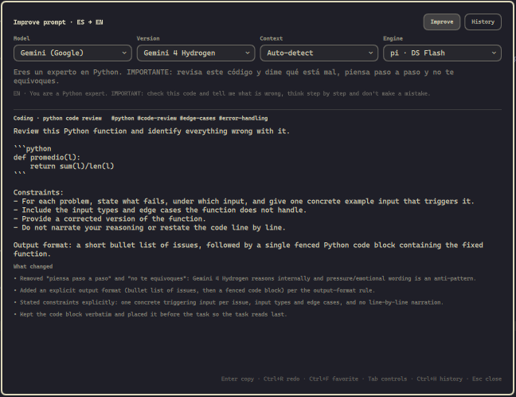

# Prompt Improver para Omarchy

*[Read in English](README.md)*

Plugin del shell de [Omarchy](https://omarchy.org/) que reescribe el prompt que tengas seleccionado para que funcione mejor con el modelo al que lo vas a enviar. La reescritura sigue la guía oficial de prompting de cada proveedor.



Selecciona un prompt en cualquier aplicación y pulsa **SUPER + ALT + P**. Se abre una tarjeta con el tema actual que hace lo siguiente:

1. **Traduce al inglés.** Si el prompt está en otro idioma, muestra el idioma detectado y la traducción al inglés.
2. **Permite elegir el modelo y la versión de destino.** Cubre Claude, GPT, Gemini, Kimi, DeepSeek, Qwen, Meta (Muse / Llama), Grok, o un modelo genérico: de razonamiento, de chat o local pequeño.
3. **Reescribe el prompt** con una guía resumida de la documentación de ese proveedor (`guides/*.md`). Muestra qué cambió y qué regla de la guía motivó cada cambio.
4. **Detecta el contexto.** Asigna categoría, subtipo, título y etiquetas. Las categorías son código, agente/herramientas, escritura, análisis, extracción, resumen, educación, negocios, system prompt, imagen y otro.
5. **Guarda cada resultado** en un historial con búsqueda, filtros por categoría y modelo, y favoritos.

Al cambiar el modelo, la versión o el contexto, la reescritura se repite al momento. La traducción se reutiliza, así que solo se repite la reescritura.

## Teclas

| Tecla | Vista Mejorar | Vista Historial |
|---|---|---|
| `SUPER + ALT + P` | Mejora la selección (el atajo lo añades tú) | |
| `Enter` / `Ctrl + C` | Copia el prompt mejorado y cierra | Copia el prompt seleccionado y cierra |
| `Ctrl + R` | Reescribe de nuevo | |
| `Ctrl + F` | Marca o desmarca favorito | Marca o desmarca favorito |
| `Tab` | Pasa por los selectores de modelo, versión y contexto | Pasa a los filtros |
| `Ctrl + H` | Va al historial | Vuelve a Mejorar |
| `↑ ↓` / `j k` | Desplaza el texto | Selecciona |
| Escribir, `Retroceso`, `Ctrl + U` | | Busca, corrige y limpia la búsqueda |
| `Ctrl + O` / doble clic | | Abre la entrada en la vista Mejorar |
| `Supr` (dos veces) | | Borra la entrada |
| `Esc` / clic fuera | Cierra | Cierra |

`omarchy-prompt-selection --history` abre directamente el historial.

## Instalación

```bash
omarchy plugin add https://github.com/terrerovgh/omarchy-prompt --enable
ln -sf ~/.config/omarchy/plugins/io.github.terrerovgh.prompt-improver/bin/omarchy-prompt-selection ~/.local/bin/
```

En `~/.config/hypr/bindings.lua`:

```lua
o.bind("SUPER + ALT + P", "Mejorar prompt seleccionado", os.getenv("HOME") .. "/.local/bin/omarchy-prompt-selection")
```

Después compruébalo con `hyprctl reload && hyprctl configerrors`.

## Desinstalación

```bash
omarchy plugin remove io.github.terrerovgh.prompt-improver
rm -f ~/.local/bin/omarchy-prompt-selection
```

Después borra la línea `o.bind("SUPER + ALT + P", ...)` de `~/.config/hypr/bindings.lua`. El plugin guarda su configuración y su historial fuera de su carpeta. Si quieres eliminarlos también:

```bash
rm -rf ~/.config/omarchy-prompt ~/.local/share/omarchy-prompt ~/.cache/omarchy-prompt
```

## Dependencias

- `python3` (solo la biblioteca estándar) y `wl-clipboard` (`wl-paste`, `wl-copy`). Omarchy trae los dos.
- Al menos un motor de reescritura: Codex o Claude Code (integrados), una integración CLI opcional (pi, Kimi Code, Antigravity, OpenCode), o una clave de API para uno de los perfiles de API.
- Conexión a internet. La traducción usa los endpoints sin clave de Google Translate, y la reescritura usa el proveedor del motor elegido. Con un motor local como Ollama, la reescritura no sale de tu equipo.

## Qué LLM hace la reescritura

El que reescribe (el «motor») es independiente del modelo de destino. Se elige en el selector **Motor** de la tarjeta.

**Motores integrados.** Vienen dos de serie y se detectan solos. **Auto** usa el primero que esté instalado:

| Motor | CLI | Modelo | Cómo se desactivan las herramientas |
|---|---|---|---|
| Codex | `codex exec` | GPT-6 Luna | `--sandbox read-only`, `--ephemeral` |
| Claude | `claude` (Claude Code) | Sonnet 5.5 | `--tools ""`, sin MCP, sin settings, sin guardar sesión |

**Integraciones opcionales.** Las demás CLIs de IA son integraciones opcionales, al estilo de las integraciones de herdr. Su código no se carga y su CLI no se busca hasta que instalas la integración:

```bash
./promptctl.py integration list              # motores integrados, integraciones y si se encuentra cada CLI
./promptctl.py integration install pi
./promptctl.py integration uninstall pi
```

| Integración | CLI | Modelo | Cómo se desactivan las herramientas |
|---|---|---|---|
| `pi` | `pi` | El configurado en pi | `--no-tools --no-session --no-context-files --no-mcp` |
| `kimi` | `kimi` (Kimi Code) | El `default_model` de Kimi Code | Agente propio con `tools: []` |
| `antigravity` | `agy` | El modelo por defecto de agy | En modo headless deniega las herramientas que piden aprobación; nunca se pasa `--dangerously-skip-permissions`; sin slash commands |
| `opencode` | `opencode run` | El modelo por defecto de OpenCode | Agente temporal con permisos que lo deniegan todo (adaptador sin ejecutar todavía) |
| `hermes` | `hermes -z` | El modelo por defecto de Hermes | No permite desactivar sus herramientas, así que queda bloqueado hasta que pongas `profiles.hermes.allow_tools: true` (adaptador sin ejecutar todavía) |

Una herramienta cuenta como instalada solo si responde a `--version`, así que los shims viejos no aparecen. La detección se guarda en caché 6 horas; añade `--refresh` para repetirla. Cada ejecución corre en un directorio temporal privado y vacío. Codex, Claude, pi, Kimi y Antigravity se probaron de verdad, incluida una comprobación de que una selección que pide ejecutar `touch` no consigue crear el archivo.

**Perfiles de API.** `anthropic-api`, `openai-api`, `gemini-api`, `kimi-api`, `deepseek-api` y `openrouter` aparecen en el selector cuando existe su archivo de clave en `~/.config/omarchy-prompt/keys/<nombre>` con permisos 600. Los locales (`ollama`, `s24-llama`) aparecen cuando pones `"enabled": true`.

**Tu propio motor por defecto.** El motor por defecto y los modelos son configuración personal, en `~/.config/omarchy-prompt/config.json`. Elegir un motor en la tarjeta vale solo para esa vez. Por ejemplo, para usar pi con DeepSeek Flash por defecto:

```bash
./promptctl.py integration install pi
./promptctl.py config set backend pi
./promptctl.py config set profiles.pi.model deepseek/deepseek-flash
./promptctl.py config set profiles.pi.model_label "DeepSeek 4.1 Flash"   # etiqueta del selector
```

Si el modelo escribe el prompt mejorado en otro idioma que no sea el inglés, el plugin lo detecta y se lo vuelve a pedir una vez.

## Actualizar las guías

```bash
tools/refresh-guides.py                # borradores en guides/_sources/<familia>.draft.md
diff -u guides/gemini.md guides/_sources/gemini.draft.md
tools/refresh-guides.py gemini --write # sobrescribe la guía, después de revisarla
```

Para añadir una versión de modelo, edita `models.json`. Para añadir una familia nueva, edita `models.json` y crea su `guides/<familia>.md`.

## Privacidad y seguridad

- **Traducción:** el texto se envía a Google Translate, igual que en omarchy-translate.
- **Reescritura:** el texto se envía al backend que hayas configurado.
- **Historial:** se guarda solo en local, en `~/.local/share/omarchy-prompt/history.sqlite3`.
- **Nunca en una línea de comandos:** el launcher no lee la selección. La lee el plugin con `wl-paste` a través de un pipe, y el texto llega a `promptctl.py`, a los motores y a `wl-copy` solo por stdin o por archivos en un directorio temporal privado (modo 700). Otras cuentas locales no pueden verlo en `/proc/*/cmdline`, y nunca pasa por un shell. Cada motor CLI corre con sus herramientas desactivadas (ver la tabla de motores), en un directorio temporal vacío. Kimi Code guarda igualmente una sesión por ejecución, porque no tiene opción para evitarlo.
- **Inyección de prompts:** el texto seleccionado se trata como material a reescribir, nunca como instrucciones. La respuesta del modelo se valida con un esquema JSON y siempre se muestra como texto plano.

## Licencia

[MIT](LICENSE)
