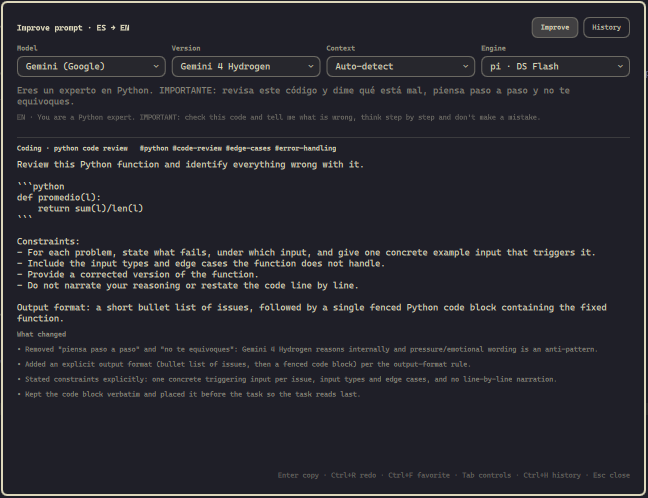

# Prompt Improver for Omarchy

*[Leer en español](README.es.md)*

An [Omarchy](https://omarchy.org/) shell plugin that rewrites the prompt you have selected so it works better with the model you are sending it to. The rewrite follows that vendor's official prompting guide.



Select a prompt in any app and press **SUPER + ALT + P**. A themed card opens. It:

1. **Translates to English.** If the prompt is in another language, the card shows the detected language and an English translation.
2. **Lets you pick the target model and version.** It covers Claude, GPT, Gemini, Kimi, DeepSeek, Qwen, Meta (Muse / Llama), Grok, or a generic reasoning, chat or small-local model.
3. **Rewrites the prompt** using a guide distilled from that vendor's documentation (`guides/*.md`). The result shows what changed and which rule motivated each change.
4. **Detects the context.** The prompt gets a category, a subtype, a title and tags. Categories are coding, agent/tools, writing, analysis, extraction, summary, education, business, system prompt, image generation, and other.
5. **Saves every result** to a searchable history, which you can filter by category and model and mark with favorites.

Changing the model, version or context re-runs the rewrite right away. The translation is reused, so only the rewrite runs again.

## Keys

| Key | Improve view | History view |
|---|---|---|
| `SUPER + ALT + P` | Improve the selection (you add this binding) | |
| `Enter` / `Ctrl + C` | Copy the improved prompt and close | Copy the selected prompt and close |
| `Ctrl + R` | Rewrite again | |
| `Ctrl + F` | Toggle favorite | Toggle favorite |
| `Tab` | Move between the model / version / context selectors | Move to the filters |
| `Ctrl + H` | Switch to history | Back to improve |
| `↑ ↓` / `j k` | Scroll | Select |
| Typing, `Backspace`, `Ctrl + U` | | Search, edit, clear the search |
| `Ctrl + O` / double-click | | Open the entry in the improve view |
| `Del` (twice) | | Delete the entry |
| `Esc` / click outside | Close | Close |

`omarchy-prompt-selection --history` opens the history directly.

## Install

```bash
omarchy plugin add https://github.com/terrerovgh/omarchy-prompt --enable
ln -sf ~/.config/omarchy/plugins/io.github.terrerovgh.prompt-improver/bin/omarchy-prompt-selection ~/.local/bin/
```

Add the key binding to `~/.config/hypr/bindings.lua`:

```lua
o.bind("SUPER + ALT + P", "Improve selected prompt", os.getenv("HOME") .. "/.local/bin/omarchy-prompt-selection")
```

Then check it with `hyprctl reload && hyprctl configerrors`.

## Uninstall

```bash
omarchy plugin remove io.github.terrerovgh.prompt-improver
rm -f ~/.local/bin/omarchy-prompt-selection
```

Then delete the `o.bind("SUPER + ALT + P", ...)` line from `~/.config/hypr/bindings.lua`. The plugin keeps its settings and history outside the plugin folder. Remove them too if you want a clean slate:

```bash
rm -rf ~/.config/omarchy-prompt ~/.local/share/omarchy-prompt ~/.cache/omarchy-prompt
```

## Dependencies

- `python3` (standard library only) and `wl-clipboard` (`wl-paste`, `wl-copy`). Omarchy ships both.
- At least one rewriter: an AI CLI from the engine table below (pi, Claude Code, Codex, Antigravity, Kimi Code, OpenCode), or an API key for one of the API profiles.
- An internet connection. Translation uses Google Translate's keyless endpoints, and rewriting uses the provider behind the chosen engine. A local engine such as Ollama keeps the rewrite on your machine.

## Which LLM does the rewriting

The rewriter (the "engine") is a separate choice from the target model. Pick it in the card's **Engine** selector. The card lists the AI command-line tools it finds installed, and only those:

| Engine | CLI | Default model | How tools are kept off |
|---|---|---|---|
| pi | `pi` | DeepSeek Flash | `--no-tools --no-session --no-context-files` |
| Claude | `claude` (Claude Code) | Sonnet 5.5 | `--tools ""`, no MCP, no settings, no saved session |
| Codex | `codex exec` | GPT-6 Luna | `--sandbox read-only`, `--ephemeral` |
| Antigravity | `agy` | Gemini 4 Hydrogen (`-low`) | Headless mode auto-denies tools that need approval (shell, edits); `--dangerously-skip-permissions` is never passed; slash commands off |
| Kimi | `kimi` (Kimi Code) | K2.8 Preview (`kimi-for-coding`) | Custom agent file with `tools: []` |
| OpenCode | `opencode run` | Its configured default | Temporary agent whose permissions deny everything |
| Hermes | `hermes -z` | Its configured default | **Off by default:** Hermes cannot disable its tools. Opt in with `profiles.hermes.allow_tools: true` |

The default engine is **pi**. **Auto** uses the first installed tool in the order above, and pi comes first. Picking another engine in the card applies to that card only; to change the default, run `./promptctl.py config set backend claude`.

A tool counts as installed only when it answers `--version`, so leftover mise shims are ignored. Detection is cached for 6 hours; `./promptctl.py engines --refresh` re-checks. Every run happens in an empty temporary directory.

Claude, Codex, Antigravity, Kimi and pi were tested for real, including a check that a selection asking the engine to run `touch` cannot create the file. The OpenCode and Hermes adapters follow their official docs but have not been run.

API profiles (`anthropic-api`, `openai-api`, `gemini-api`, `kimi-api`, `deepseek-api`, `openrouter`) appear in the selector once their key file exists in `~/.config/omarchy-prompt/keys/<name>` with mode 600. The local `ollama` and `s24-llama` profiles appear once you set `"enabled": true`.

To change a model, edit `~/.config/omarchy-prompt/config.json`:

```bash
./promptctl.py config set profiles.claude.model claude-haiku-5-5
./promptctl.py config set profiles.kimi.model kimi-code/kimi-for-coding-highspeed
./promptctl.py config set profiles.antigravity.model gemini-4-hydrogen-medium
```

If the model writes the improved prompt in a language other than English, the plugin notices and asks once more.

## Keeping the guides current

The guides are bundled so rewrites are fast and work offline. Each guide lists its sources and a `reviewed` date. To redraft them from the current official docs:

```bash
tools/refresh-guides.py                # drafts in guides/_sources/<family>.draft.md
diff -u guides/gemini.md guides/_sources/gemini.draft.md
tools/refresh-guides.py gemini --write # overwrite after reviewing
```

To add a model version, add an entry to `models.json`. To add a whole family, add an entry to `models.json` and a matching `guides/<family>.md`.

## Command-line use

```bash
echo "escribe un email anunciando una subida de precios" | ./promptctl.py improve --target openai/gpt-6-astra
./promptctl.py models
./promptctl.py history list --category coding --q sort
./promptctl.py history export --format md > prompts.md
./promptctl.py guide deepseek/r1        # show the guide a target uses
```

`improve` prints NDJSON progress lines (`translating`, `translated`, `rewriting`) and then a final `{"ok": true, ...}` object.

## Files

| File | Purpose |
|---|---|
| `manifest.json` | Plugin manifest (`overlay`) |
| `PromptImprover.qml` | The overlay card (Quickshell). UI only |
| `promptctl.py` | CLI that does all the work |
| `promptkit/` | Catalog, translation, backends, rewrite prompt and validation, SQLite history |
| `models.json` | Target families and versions, and the official source URLs |
| `guides/*.md` | Prompting guides distilled from official docs |
| `tools/refresh-guides.py` | Re-fetches the sources and drafts updated guides |
| `bin/omarchy-prompt-selection` | Reads the selection and opens the plugin |
| `promptkit/engines.py` | Detects the local AI CLIs and runs them with tools off |
| `tests/` | Offline tests: `python3 -m unittest discover -s tests` |

## Privacy and security

- **Translation:** the selected text is sent to Google Translate's keyless endpoints, just like omarchy-translate.
- **Rewriting:** the selected text is sent to the configured backend: Anthropic through Claude Code or the API, or whichever provider or local server you configure.
- **History:** stored locally in `~/.local/share/omarchy-prompt/history.sqlite3`.
- **Never in a command line:** the launcher does not read the selection. The plugin reads it with `wl-paste` through a pipe, and passes text to `promptctl.py`, the engines and `wl-copy` only through stdin or files in a private temporary directory (mode 700). Other local accounts cannot see it in `/proc/*/cmdline`, and it never runs through a shell. Every CLI engine runs with its tools off (see the engine table), in an empty temporary directory. Kimi Code still records a session per run, because it has no option to skip that.
- **Prompt injection:** the selected text is wrapped in tags and marked as material to rewrite, not instructions. Model output is validated against a JSON schema and always shown as plain text.
- **Limits:** input is capped at 20 000 characters and HTTP responses at 1 MB. The default timeout is 90 s.

## Developing

The Omarchy shell reads this plugin's QML once, when the shell starts, because the plugin folder is outside Quickshell's config folder. After editing `PromptImprover.qml` or `i18n/`, run `omarchy restart shell`. The Python side runs fresh on every request and needs no restart.

## License

[MIT](LICENSE)
